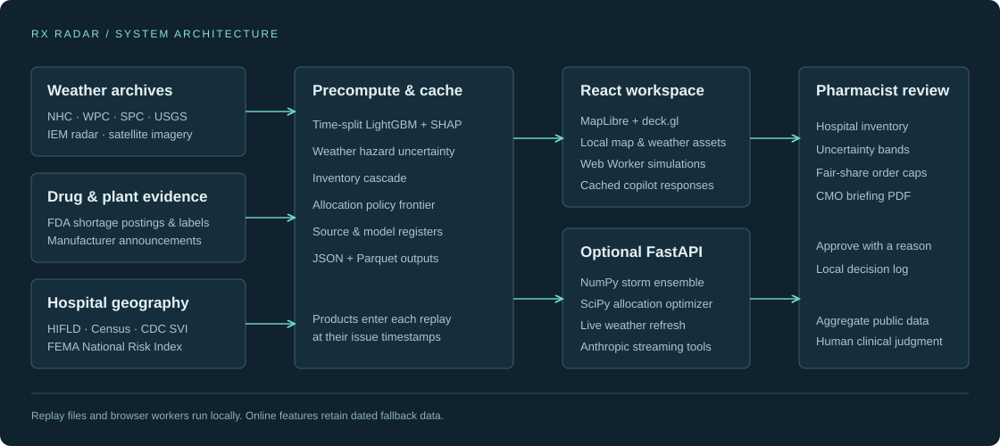

# Rx Radar

Rx Radar follows severe weather through pharmaceutical manufacturing and hospital supply chains. Replay Hurricane Helene, the Rocky Mount tornado and Hurricane Maria, inspect a hospital’s inventory assumptions, compare allocation policies, and draw another storm.

## Run locally

Use Node.js 20 or newer and Python 3.11 or newer. From this repository on Windows, macOS or Linux, run

```sh
npm run demo
```

The launcher installs missing dependencies, builds the frontend and starts the app at **http://localhost:5173** with the API at **http://127.0.0.1:8000**. Keep that terminal open. Initial installation needs internet access. The bundled replay data, maps, fonts, imagery, browser simulation workers and cached copilot operate without internet after setup.

```sh
npm run setup              # Install the complete analysis environment
npm run dev -- --no-open   # Hot reload frontend and API
npm run demo -- --no-open  # Production preview without opening a browser
npm run demo -- --no-api   # Browser simulations and cached copilot
npm run typecheck
npm run build
npm run pipeline          # Rebuild numerical outputs using cached inputs
```

Use `npm.cmd` if PowerShell blocks the npm script shim. Stop the launcher with Ctrl+C. The ports must be free.

For optional live Claude answers, copy `.env.example` to `.env` and set `ANTHROPIC_API_KEY`. The key is read only by the Python server. `ANTHROPIC_MODEL` can override the default model. Microphone input uses the browser’s Web Speech API and permission prompt. Typed questions and cached prompts remain available when speech recognition or the network is unavailable.

## Present the demo

| Key | View |
| --- | --- |
| 1 | Orbital title |
| 2 | Helene forecast replay |
| 3 | Pharmacy alert and information cutoff |
| 4 | Samaritan Hospital in Troy |
| 5 | Market, proportional and fair allocation |
| 6 | What-if storm builder |
| 7 | Children’s hospitals question and map tools |
| 8 | Impact assumptions |

Space plays or pauses. Right Arrow advances a beat. R returns to the title. N opens presenter notes. Ctrl+K or Command+K opens the command palette. Escape closes the active overlay. The hospital tab also finds Albany Medical Center.

The exact requested script and evidence notes are in [DEMO_SCRIPT.md](DEMO_SCRIPT.md). Submission copy is in [DEVPOST.md](DEVPOST.md), answers for judges in [JUDGE_QA.md](JUDGE_QA.md), and numerical limitations in [MODEL_CARD.md](MODEL_CARD.md).

## Architecture



The Vite / React / TypeScript interface uses Zustand for shared selections and the replay clock. MapLibre and deck.gl draw an offline vector basemap, dated forecast products and hospital supply risk. Static JSON bundles connect Python preprocessing to the browser.

The FastAPI service exposes `/api/health`, `/api/whatif`, `/api/allocate`, `/api/copilot` and `/api/live`. Browser workers run the storm ensemble and allocation during disconnected demonstrations. The copilot uses the same state and actions as the UI. Approved pharmacy actions and reasons are saved to browser-local storage. PDF briefings contain the current map, modeled hospital risks, actions and sources.

## Data and model evidence

The bundled hospital snapshot contains 7,105 historical HIFLD facility locations, including specialty facilities. Beds come from the archived dataset. Rurality, safety-net status, pediatric classification and health-system size include proxies recorded in each row’s `imputed` field. This dataset’s vintage is listed in the Sources panel.

NHC forecast cones and tracks, WPC and SPC outlooks, USGS gauge observations, IEM NEXRAD imagery, CDC SVI and FEMA county risk scores are locally cached. Public manufacturer reports establish key disaster and plant facts. Product-level market shares, contracts, distributor relationships, inventories, demand and financial or emissions benefits use explicit scenario assumptions. Provenance badges open the complete dataset register with retrieval dates, licenses and caveats.

The LightGBM benchmark uses FDA shortage-posting family-year records with a time split. Its measured held-out ROC AUC is **0.414**, PR AUC **0.146**, and Brier score **0.127**, with a **0.139** held-out positive rate. The incomplete FDA history and weak discrimination limit the benchmark’s usefulness. The model card exposes its calibration and subgroup evidence. Hospital outcomes lack observed labels.

The weather hazard model propagates uncertainty from expert-informed coefficient priors. Its probabilities are uncalibrated. The Helene replay’s forecast trigger precedes the conservative flood-day reference by about **32.5 hours**. All weather inputs respect issue timestamps. Historical plant metadata and retrospective cohort selection limit this to a counterfactual replay. The Rocky Mount tornado is a missed-event sensitivity case with no validated pre-event plant alert.

The cascade projects P10/P50/P90 inventory outcomes. Fair allocation solves a bounded linear program under available-supply, unmet-need caps and vulnerability-weighted coverage floors. The browser implementation solves the equivalent single-resource optimization and runs hospital ordering agents over 14 days. Assumed supply and ordering behavior are held consistent across the policies.

## Rebuild data

`npm run pipeline` rebuilds the catalog, LightGBM metrics, network, scenario snapshots, policy frontier and source register from local inputs. Analysis tables are written to `data/processed/` as Parquet and compact JSON. The app reads `web/public/data/`.

To refresh official datasets deliberately, use

```sh
.venv\Scripts\python.exe -m pipeline.run_all --refresh
```

On macOS or Linux, use `.venv/bin/python`. Source failures retain cached products or clearly marked stand-ins. All code and data structures are documented in [docs/CONTRACTS.md](docs/CONTRACTS.md).

## Team

Ethan Guo · Kevin Zhu
